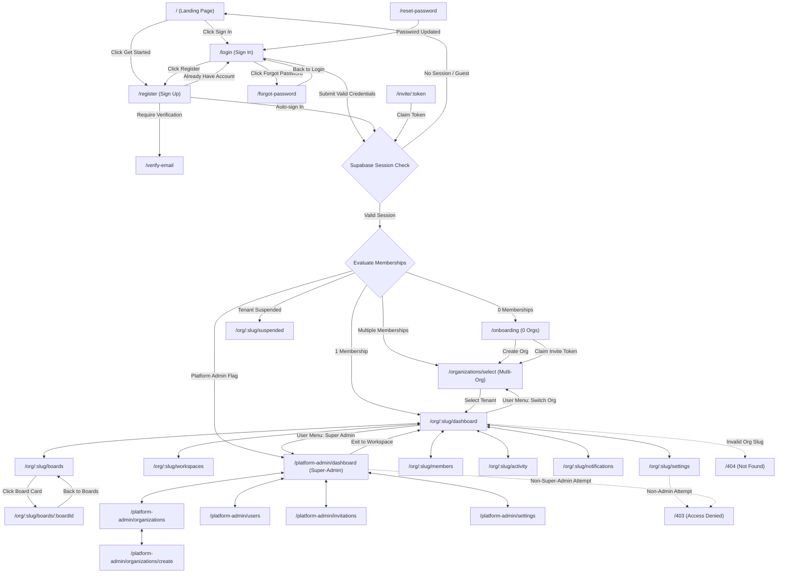
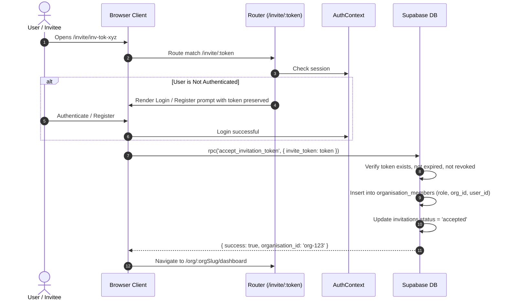

# Stratcrest Flow: Complete Application Page Flow & Navigation Architecture

This document specifies the end-to-end page flow, routing architecture, multi-tenant access control, and navigation topology for the Stratcrest Flow multi-tenant visual project management SaaS platform powered by Supabase.

---

## 1. Complete Route Directory & Access Control Matrix

| Route Path | Page Title | Access Level | Description | Key Redirect / Fallback |
| :--- | :--- | :--- | :--- | :--- |
| `/` | Landing Page | Public | Product introduction, interactive Kanban preview, architecture highlights, enterprise capability grid, hero CTA. | If logged in, header displays direct shortcut to active organisation. |
| `/login` | Sign In | Public / Guest | Supabase email & password authentication, show/hide password, "Remember me" session persistence, forgot password link. | If already authenticated, redirects automatically to default destination or `?redirect=...`. |
| `/register` | Sign Up | Public / Guest | New account creation with full name, work email, password confirmation, and Supabase email verification notice. | Upon successful registration, prompts email verification or routes to onboarding. |
| `/forgot-password` | Password Recovery | Public / Guest | Dispatches secure password reset link via Supabase GoTrue Auth service. | Links back to `/login`. |
| `/reset-password` | Set New Password | Recovery Link | Handles Supabase `#access_token` or `type=recovery` hash fragment to update user credentials. | Redirects to organisation check upon completion. |
| `/verify-email` | Email Verification | Public / Guest | Status screen displaying dispatched email notice and resend verification capability. | Links back to `/login`. |
| `/invite/:token` | Claim Invitation | Public / Auth | Cryptographic invitation token validator. Allows new or existing users to join an organisation tenant. | If unauthenticated, prompts sign-in/register before claiming; redirects to org dashboard on success. |
| `/onboarding` | Tenant Onboarding | Authenticated (0 Orgs) | Welcomes registered users who do not yet belong to any organisation. Allows self-service org creation or token input. | If user belongs to organisations, redirects to `/organizations/select`. |
| `/organizations/select` | Organisation Switcher | Authenticated (Multi-Tenant) | Displays interactive cards for all organisations the user belongs to, showing name, plan, user role, and status. | Selecting an organisation activates context and navigates to `/org/:orgSlug/dashboard`. |
| `/org/:orgSlug/dashboard` | Tenant Dashboard | Org Member | High-level metrics, active sprint boards, assigned tasks, due date alerts, and recent audit activity stream. | Requires active membership in `:orgSlug`. If suspended, routes to `/org/:orgSlug/suspended`. |
| `/org/:orgSlug/workspaces` | Workspaces Directory | Org Member | Directory of team workspaces, visibility filters (Private, Team, Organisation), and workspace creation modal. | Access restricted to verified members of `:orgSlug`. |
| `/org/:orgSlug/boards` | Kanban Boards Directory | Org Member | Starred and all boards listing grouped by workspace, quick board creation, and favorites management. | Access restricted to verified members of `:orgSlug`. |
| `/org/:orgSlug/boards/:boardId` | Board Detail (Kanban) | Org Member | Visual drag-and-drop lists, card modals, checklist progress bars, labels, attachments, activity feed, and confetti animations. | Verifies board belongs to `:orgSlug`. If board not found, shows 404 card. |
| `/org/:orgSlug/members` | Team & Invitations | Org Member | Member directory, role management (Owner, Admin, Member, Guest), and invitation token dispatcher. | Role changes and member removal restricted to Owners and Admins. |
| `/org/:orgSlug/activity` | Tenant Audit Log | Org Member | Tamper-evident tenant audit trail displaying member events, workspace changes, and JSON telemetry export. | Access restricted to verified members of `:orgSlug`. |
| `/org/:orgSlug/notifications` | Notifications | Org Member | In-app alerts, security notifications, quota warnings, and workspace announcements. | Access restricted to verified members of `:orgSlug`. |
| `/org/:orgSlug/settings` | Organisation Settings | Org Admin / Owner | Profile branding, security policies (allowed domain, invite restrictions), data export, and quota limits. | Restricted to Owners and Admins. Members receive HTTP 403 Access Denied. |
| `/org/:orgSlug/suspended` | Tenant Suspended Notice | Tenant Member | Informative security lockout screen explaining administrative suspension and providing remediation actions. | Shown automatically when `org.status === 'suspended'`. |
| `/platform-admin/dashboard` | Super-Admin Console | Platform Admin | Cross-tenant metrics (total tenants, active vs suspended, global user count, storage footprint, telemetry stream). | Restricted to `isPlatformAdmin === true`. Non-admins receive HTTP 403. |
| `/platform-admin/organizations` | Global Tenants List | Platform Admin | Supervise all platform tenants, search by name/slug/plan, suspend/reactivate tenants with audit reasons. | Platform Admin only. |
| `/platform-admin/organizations/create` | Tenant Provisioning | Platform Admin | Provision new isolated tenant organisation with owner email, initial subscription plan tier, and brand styling. | Platform Admin only. |
| `/platform-admin/users` | Platform Users Registry | Platform Admin | Complete directory of registered users across all tenants, showing associated organisations and privilege levels. | Platform Admin only. |
| `/platform-admin/invitations` | Global Invitation Registry| Platform Admin | Monitor all pending, accepted, and revoked invitation tokens across all platform organisations. | Platform Admin only. |
| `/platform-admin/settings` | Quotas & Break-Glass | Platform Admin | Subscription plan quota configuration (limits on members, workspaces, boards, storage) and emergency break-glass sessions. | Platform Admin only. |
| `/404` | Page Not Found | Public | Modern 404 error screen with "Go Back" and "Return Home" actions. | Default fallback for unknown routes. |
| `/403` | Access Restricted | Authenticated | HTTP 403 Forbidden screen detailing permission deficiency and offering organisation switcher or logout. | Rendered when attempting unauthorized access. |
| `/500` | Server Error | Public | HTTP 500 Unexpected Error screen with retry mechanism and diagnostic stack trace display. | Rendered on fatal runtime exceptions. |

---

## 2. Page-to-Page Navigation Diagram

---

## 3. Authentication & Session Flow

1. **Initial Boot & Token Hydration**:
   - `AuthProvider` connects to Supabase GoTrue Auth client via `supabase.auth.getSession()`.
   - Listens to real-time events via `supabase.auth.onAuthStateChange((event, session) => ...)`:
     - `SIGNED_IN`, `USER_UPDATED`, `TOKEN_REFRESHED`: calls `syncUserSession(session)`.
     - `PASSWORD_RECOVERY`: automatically sets route to `/reset-password`.
     - `SIGNED_OUT`: purges `stratcrest_active_org_id` from `localStorage` and resets state.

2. **Sign In (`/login`)**:
   - Accepts user email and password with live client-side validation.
   - Calls `authService.signIn(email, password)`.
   - On success:
     - If query parameter `?redirect=...` exists, immediately navigates to that path.
     - Otherwise, computes destination based on user memberships:
       - 0 memberships -> `/onboarding`
       - 1 membership -> `/org/${memberships[0].organisation.slug}/dashboard`
       - 2+ memberships -> `/organizations/select`
       - Platform admin -> `/platform-admin/dashboard`

3. **Sign Up (`/register`)**:
   - Collects full name, email, password, and confirm password.
   - Calls `authService.signUp(fullName, email, password)` with `raw_user_meta_data.full_name`.
   - Database trigger `handle_new_user()` creates an isolated `public.profiles` entry.
   - If email verification is enabled by Supabase, transitions to verification pending screen or `/verify-email`.

4. **Sign Out**:
   - `logout()` executes `supabase.auth.signOut()`, clears tenant cache in `localStorage`, and redirects to `/login`.

---

## 4. Multi-Tenant Organisation Context & Switching

1. **URL-Driven Tenancy**:
   - Every tenant page lives under `/org/:orgSlug/...`.
   - The router inspects `:orgSlug` and matches against the database.
   - **Never trusts client parameters**: The server verifies that the current `auth.uid()` has an active membership record in `organisation_members` for that specific `organisation_id`.

2. **Multi-Organisation Selector (`/organizations/select`)**:
   - Rendered when a user belongs to multiple organizations.
   - Each card displays organisation brand color, name, subscription tier, and the user's specific role in that tenant (`Owner`, `Admin`, `Member`, `Guest`).
   - Clicking an organisation executes `selectOrganisation(org.id)` and navigates to `/org/${org.slug}/dashboard`.

3. **Header Organisation Switcher**:
   - The user profile dropdown in `Header` and `UserMenuDropdown` provides an instant "Switch Organisation" button that returns to `/organizations/select`.
   - Selecting a new organisation updates `tenantService.setActiveOrgId(org.id)` and reloads all workspaces, boards, members, and audit streams with zero state leakage.

---

## 5. Role-Based Access Control (RBAC) Flow

| User Role | Dashboard | Boards & Cards | Invite Members | Change Roles | Remove Members | Org Settings | Platform Admin |
| :--- | :---: | :---: | :---: | :---: | :---: | :---: | :---: |
| **Owner** | Yes | Yes (Full) | Yes | Yes | Yes | Yes | If granted |
| **Admin** | Yes | Yes (Full) | Yes | Yes | Yes | Yes | If granted |
| **Member** | Yes | Yes (Full) | View only | No (403) | No (403) | No (403) | No (403) |
| **Guest** | Yes | Assigned only | No (403) | No (403) | No (403) | No (403) | No (403) |
| **Platform Admin** | Yes | Supervise | Global | Global | Global | Yes | Full Console |

- **Route Guarding**:
  - Visiting `/org/:orgSlug/settings` inspects the user's role in `:orgSlug`. If role is not `owner` or `admin`, rendering aborts and displays `<AccessDeniedPage />`.
  - Visiting any `/platform-admin/*` route inspects `userProfile.isPlatformAdmin`. If false, rendering displays `<AccessDeniedPage />`.

---

## 6. Invitation Acceptance Flow (`/invite/:token`)

---

## 7. Error Handling & Redirect Matrix

| Trigger / Condition | Detected By | Action Taken | UI Rendered |
| :--- | :--- | :--- | :--- |
| Unauthenticated access to `/org/*` or `/platform-admin/*` | `AppRouter` guard | Redirects to `/login?redirect={path}` | `LoginPage` |
| Authenticated access to `/login` or `/register` | `AppRouter` `useEffect` | Redirects to user's org dashboard or selector | Org Dashboard / Select Org |
| Non-existent route (e.g. `/unknown-path`) | `AppRouter` fallback | None | `NotFoundPage` (404) |
| User enters `/org/invalid-slug` | `AppRouter` org lookup | None | `NotFoundPage` (404) |
| Member accesses `/org/:slug/settings` | `AppRouter` role check | Rejects access | `AccessDeniedPage` (403) |
| Non-admin accesses `/platform-admin/*` | `AppRouter` platform check | Rejects access | `AccessDeniedPage` (403) |
| Tenant status is `'suspended'` | `AppRouter` status check | Redirects to `/org/:slug/suspended` | `OrgSuspendedPage` |
| Fatal JavaScript exception or crash | React Error Boundary / Route error | Captures exception message | `ServerErrorPage` (500) |
| Token expired on `/invite/:token` | `InviteClaimPage` handler | Displays error banner | Re-enter token or contact admin |
